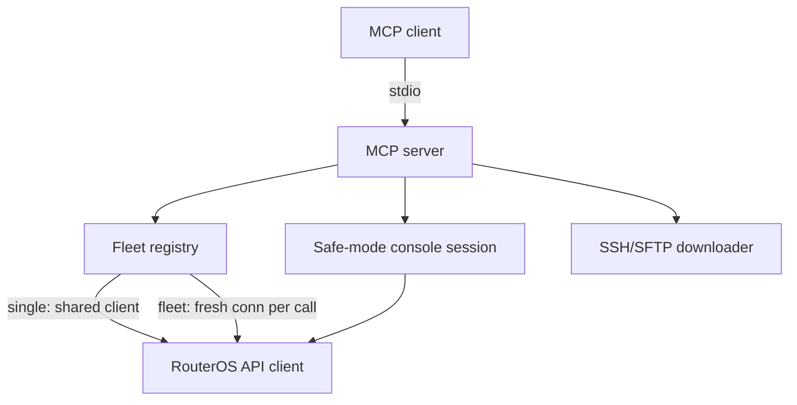

# Architecture

The server is a thin MCP adapter over the native RouterOS API: one process,
one stdio transport, one client per device, with safe mode and file transfer
as the only stateful paths.

## Core Components

- **MCP server:** registers all tools and routes each call to the target device.
- **Fleet registry:** single device from flat env, or a validated JSON inventory.
- **RouterOS API client:** lazy TLS connections with verified certs and private-CA files.
- **Safe mode:** mutating tools run through a held console session until commit or rollback.
- **File transfer:** fingerprint-pinned SFTP confined to the workspace root.
- **Healthcheck:** probes API, SCP, and passwordless readiness in one call.

## Invariants & Guarantees

- **TLS by default:** verified certs; typos in TLS switches fail startup, never downgrade.
- **SSH fails closed:** no pinned fingerprint and no explicit insecure opt-out means refusal.
- **Contained downloads:** absolute paths escaping the workspace are rejected.
- **Cancellable long runs:** `resource_listen`, `tool_ping`, `tool_traceroute` are interrupted on cancel.
- **Safe mode reverts:** uncommitted changes vanish on rollback or disconnect.

Deep contributor internals live in [Development](development.md).

## Protocol Conformance

The client is implemented and tested against MikroTik's official artifacts:

- **API protocol** — [RouterOS API](https://manual.mikrotik.com/docs/developer-guides/api/)
  documents framing, word-length encoding, sentences, queries, `.tag`, and
  `/login` + `/cancel` semantics, with exact example reply traces.
- **Reference client** — [Python3 example](https://manual.mikrotik.com/docs/developer-guides/api/python3-example)
  is MikroTik's own wire-protocol implementation. Our encoder matches it
  byte-for-byte for every length class (`TestEncodeSentenceMatchesOfficialReference`).
- **REST API** (RouterOS 7) — a cross-reference for command paths and
  attribute names; the server speaks the native binary protocol.

There is **no official Go SDK or conformance suite**. `github.com/mikrotik`
is **not** an official MikroTik org (unrelated third-party repos).

## Why Not `go-routeros/routeros/v3`?

[go-routeros/routeros/v3](https://github.com/go-routeros/routeros) (MIT,
~270★) is the de-facto standard Go RouterOS library, and `internal/client`'s
low-level protocol core overlaps its `proto` package. We keep our own client
because it layers semantics the library doesn't ship: bounded auto-cancel
`listen`, `RunContext`/`ListenContext` that issue `/cancel` on request
cancellation, `Clone`/`Isolated` per-command connections,
certificate-fingerprint healthcheck data, and the RouterOS error taxonomy.
The protocol layer is verified byte-for-byte against the official spec, and
the library has had no release since Feb 2025. If that maintenance risk ever
outweighs it, `internal/client` is the single seam to swap out.
